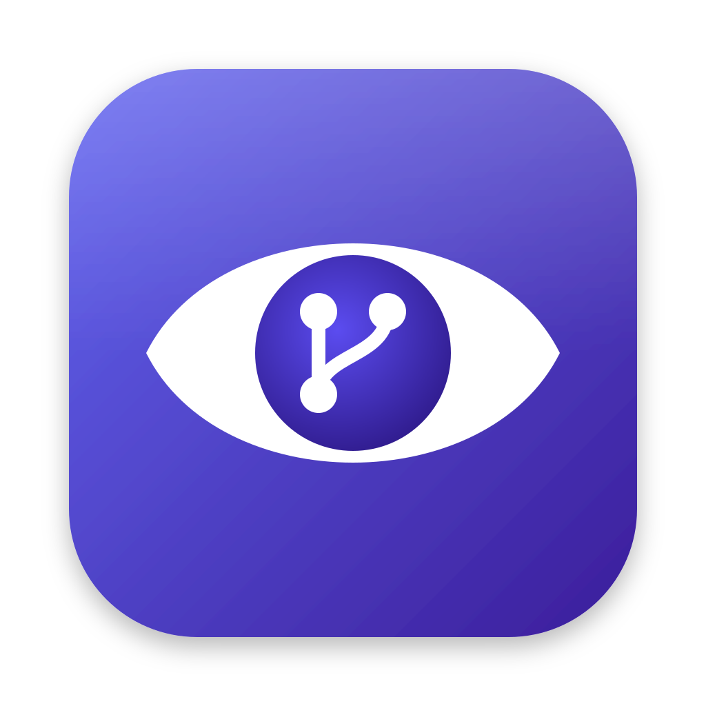

<p align="center">
  
</p>

<h1 align="center">PRsight</h1>

<p align="center">
  Review related pull requests together: see how changes across PRs and repos connect,<br>
  what must ship together, and what to check before you approve.
</p>

<p align="center">
  <a href="LICENSE"></a>
  
  
</p>

---

A single change often spans several pull requests: a config repo, a library, a service and a doc. GitHub shows each PR on its own, so the connections between them live in the reviewer's head. PRsight puts them side by side.

Pick the PRs that belong together and PRsight builds a report from rules, with no AI needed. AI explanations are optional and off by default.

## Features

- **Report:** a verdict and progress bar, a summary of what changes, risks grouped by severity, and a review checklist with blockers first.
- **File Map:** a graph of the changed files across all PRs, with the cross-PR links drawn between them.
- **Cross-PR links**, each backed by the exact file and line:
  - the same rename in two PRs, which must ship together
  - an old name still in use somewhere else
  - record contracts between a writer and a reader
  - config that feeds a module
  - limits and names that are shared
  - docs that describe the change
- **Findings:** comments from Copilot and other AI reviewers, scanner results (Wiz, Snyk, Sonar and others) and the app's own rules, such as large limit changes or logic changed without a test.
- **Team rules:** checks drawn from `AGENTS.md`, `CLAUDE.md` and `.github/copilot-instructions.md` in each repo.
- **PR hygiene:** empty or template-only descriptions, unticked checklists, descriptions that are out of date, and titles that break the repo's style.
- **Changes tab:** a GitHub-style diff with line comments, pending reviews, Reply and Resolve.
- **Tickets:** finds Azure DevOps (`AB#123`) and Jira (`KEY-123`) tickets in titles, branches and commits, and can show their details.
- **Optional AI:** plain-language explanations from your choice of provider, clearly labelled as AI.

## Download

Get the latest version from [Releases](https://github.com/prasadzende/PRsight/releases/latest):

| Your computer | File |
|---|---|
| Mac with Apple Silicon (M1 or later) | `PRsight-<version>-mac-arm64.dmg` |
| Mac with an Intel processor | `PRsight-<version>-mac-x64.dmg` |
| Windows | `PRsight-<version>-win-x64.exe` |

A new version is released every time a change is merged into `main`.

### First launch

PRsight isn't signed with a paid Apple or Microsoft certificate, so your computer warns you the first time you open it.

- **Mac:** open the `.dmg` and drag PRsight to Applications, then open it.
  - If macOS says it **can't verify** the app, go to **System Settings › Privacy & Security**, scroll down and click **Open Anyway**.
  - If it says the app **is damaged**, run this once in Terminal, then open it again:
    ```bash
    xattr -dr com.apple.quarantine /Applications/PRsight.app
    ```
- **Windows:** if SmartScreen says it protected your PC, click **More info › Run anyway**.

### Updates

PRsight checks for a new version shortly after it starts, then daily. You can change this, or turn it off, in **Settings › Privacy & Data**; **Check for Updates…** in the app menu checks straight away. When there's a new version, a bar at the top of the window tells you:

- **Windows:** click **Update Now**, then **Restart Now** to install it.
- **Mac:** click **Download** to get the new `.dmg` from GitHub, then replace the app in Applications. macOS only lets signed apps update themselves.

## Build from source

```bash
git clone https://github.com/prasadzende/PRsight.git
cd PRsight
corepack enable      # gives you pnpm
pnpm install         # also rebuilds the native SQLite module for Electron
pnpm dev             # starts the app with hot reload
```

You need Node 22 or later. To build an installer yourself, run `pnpm package:mac` or `pnpm package:win`; the files land in `dist/`.

## Sign in

**GitHub**, any one of:
- **Use My GitHub CLI Sign-In:** reuses `gh auth login`. This is the quickest way to start.
- **A personal access token.** A fine-grained token with read access to the repos, plus Pull requests: read & write if you want to comment.
- **Sign In with GitHub (device flow):** needs a GitHub App client ID (see [Your own GitHub App](#your-own-github-app)).

Set an organisation in **Settings › Accounts** to list its PRs and repos. Leave it blank to use your own account.

**Tickets (optional)**, in **Settings › Boards**:
- **Azure DevOps:** your Azure CLI sign-in (`az login`), a personal access token, or an Entra app registration.
- **Jira:** your site and an API token.

**AI (optional)**, in **Settings › AI**. Choose one provider:

| Provider | What it needs |
|---|---|
| Claude subscription (Claude Code) | The `claude` CLI, signed in. No API key. |
| Anthropic API, OpenAI, Google Gemini | Your API key |
| Claude in Microsoft Foundry, Azure OpenAI | Your endpoint and API key |
| Amazon Bedrock | Your AWS credentials (profile or SSO) |
| Google Vertex AI | Google Cloud application default credentials |

## Privacy and security

- **Your data stays on your computer.** Reports, cache and settings are kept in a local SQLite database. Tokens and keys are encrypted with the macOS Keychain or Windows DPAPI.
- **Network calls are limited.** Only the main process makes requests, and only to an allow-list of hosts: GitHub, your boards and your chosen AI provider. The window itself can't reach the network at all.
- **AI is off by default.** When you turn it on, tokens, keys, IDs and email addresses are removed before anything is sent. Every report is complete without AI.
- **GitHub writes happen only when you click.** The app posts comments, replies and reviews and resolves threads only when you press that button. It never writes anything else.
- **No telemetry.** The only call made without you asking is the update check, which reads the latest release from GitHub. Turn it off in **Settings › Privacy & Data**.

See [SECURITY.md](SECURITY.md) to report a vulnerability.

## Your own GitHub App

To use **Sign In with GitHub**, register a GitHub App and turn on device flow. It needs these permissions:

- **Read:** Contents, Metadata, Checks and Members
- **Read & write:** Pull requests and Issues

Put its client ID in **Settings › Accounts**, or in the `PRGRAPH_GITHUB_CLIENT_ID` environment variable. Installing the App on an organisation needs an owner of that organisation to approve it.

## Development

| Command | What it does |
|---|---|
| `pnpm dev` | Run the app with hot reload |
| `pnpm test` | Unit tests and golden tests |
| `pnpm typecheck` | TypeScript, for the main process and the renderer |
| `pnpm lint` | ESLint |
| `pnpm e2e` | Build, then run the Playwright smoke test |
| `pnpm package:mac` / `pnpm package:win` | Build an installer |

```
src/main/       main process: window, menus, IPC, GitHub client, boards, AI providers, storage, network allow-list
src/preload/    the bridge the window uses (the only API it can see)
src/renderer/   React UI: sidebar, PR list, PR details, report, file map, changes, settings
src/worker/     background process that runs the analysis
src/analysis/   the rule engine: diff parsing, classification, tickets, links, findings, team rules, report
src/shared/     domain model and typed IPC schemas
tests/          unit tests and golden tests (with invented fixtures)
```

[docs/design.md](docs/design.md) explains how the app is built and the choices behind it.

### Releases

`.github/workflows/release.yml` runs on every push to `main` (pushes that only change docs are skipped):

1. **Version:** taken from the first two numbers in `package.json` plus the run number, e.g. `0.1.27`. To start a new line, change `version` in `package.json`, e.g. to `0.2.0`.
2. **Draft release:** a draft GitHub Release is created with generated notes.
3. **Builds:** lint, typecheck and tests run on macOS and Windows, then the installers are uploaded to the draft.
4. **Publish:** once every build has uploaded, the release is published and becomes the one the app updates to. If a build fails, the draft is deleted.

## Contributing

Bug reports, ideas and pull requests are welcome. Read [CONTRIBUTING.md](CONTRIBUTING.md) to get started, and follow the [Code of Conduct](CODE_OF_CONDUCT.md).

## Licence

[MIT](LICENSE) © 2026 Prasad Zende
